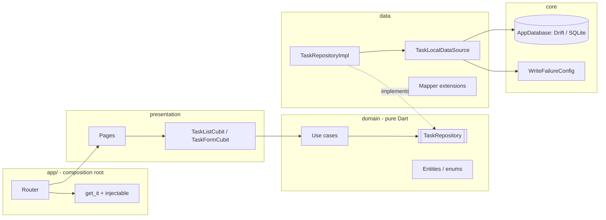

# Design

## 1. Architecture: feature-first Clean Architecture

The code is split by feature (`features/tasks/{domain,data,presentation}`), and
dependencies point inward. **Domain** is pure Dart. Its only package import is
`freezed_annotation` (annotations only), which the brief requires. Use cases
are registered in `app/di/tasks_module.dart`, so the domain layer has no
injectable imports. **Data** owns all SQL (`TaskLocalDataSource`). The
repository maps models to entities (through extension methods in
`data/mappers/`) and converts data exceptions into the domain's sealed
`TaskFailure`. **Presentation** only calls use cases. `getIt` is read only in
`main.dart` and the router.

Feature-first was chosen because the risky logic (transactions, concurrency)
sits behind a narrow repository contract that can be tested against real
SQLite in isolation. It also scales by adding folders, not by touching shared
layers.

**Rejected alternative:** a layer-first layout with a cubit talking straight to
a DAO. It's less code, but the persistence rules would leak into the cubit and
there'd be no seam to test atomicity separately from the UI. Riverpod and BLoC
with events were also rejected, because the brief asks for Cubit.

## 2. Entities and models

- **Domain:** `TaskEntity`, `TaskActivityEntity`, `TaskQuery` (search + priority + completion filter), plus the `TaskPriority`, `ActivityType` and `CompletionFilter` enums.
- **Data:** `TaskModel` and `TaskActivityModel` are Freezed + json_serializable DTOs that store enums as `name` strings. JSON isn't used today; these are the shapes a sync API would exchange (§9).
- **Storage:** Drift tables `tasks` and `task_activities`, with `task_id` as a foreign key to `tasks.id` using **ON DELETE CASCADE**, plus indexes for filters, list order and the timeline. IDs are client-generated UUIDs. Timestamps are stored as ISO text for millisecond precision, and the timeline is ordered by `created_at, rowid`.
- **Mapping:** row → model → entity, done only through extension methods. Parsing is safe: an unknown priority falls back to `medium`, and an unknown activity type is skipped rather than crashing.
- **Versioning:** `schemaVersion = 1`. `onUpgrade` delegates to `migrations.dart`, which documents a stepwise `if (from < N)` pattern. The v1 schema is dumped to `drift_schemas/`.

## 3. Atomic task + activity writes

Every mutation in `TaskLocalDataSource` runs inside **one `db.transaction`**:

| Operation | Inside the transaction |
|---|---|
| create | insert task → **guard** → insert `created` |
| update | read row (missing → not found) → diff the normalized input; **no diff → return `false` and write nothing** → update only the changed columns → **guard** → if priority changed, insert `priorityChanged(old, new)` |
| complete / reopen | `UPDATE … SET completed = X WHERE id = ? AND completed = !X` → 0 rows: task exists → no-op `false`, task missing → not found; 1 row → **guard** → insert the event |
| delete | `DELETE` (activities cascade in the same statement) → 0 rows → not found → **guard** |

The **guard** is `WriteFailureConfig.throwIfEnabled()`. It always runs right
after the first write, including for single-write operations, so a simulated
failure always forces a real rollback. Title and description are normalized
(trimmed; an empty description becomes `null`) by one shared helper, used both
by the form's local "unchanged?" check and by the data source's diff. That way
`null` and `""` can't register as a change.

## 4. Cubits

- **TaskListCubit** handles load, debounced search, immediate filters, complete/reopen/delete and retry. State is `status` (initial/loading/success/empty/failure), `tasks`, `query`, `pendingTaskIds` and a transient `actionError`. There are **no optimistic updates**: after every mutation, successful or not, the list reloads from the database with the *current* query. `close()` cancels the debounce timer.
- **TaskFormCubit** is one form for create and edit (factory parameter: the task being edited, if any). It handles field state, title validation and a local unchanged check, and keeps the input on failure, where pressing Save again retries.
- The timeline sheet calls the `GetTaskActivities` use case through a `FutureBuilder`. It's a single read with no state transitions, so a third cubit would be ceremony.

## 5. Failure handling and rollback

Repositories **throw** a sealed `TaskFailure` (`WriteFailedFailure`,
`TaskNotFoundFailure`, `InvalidInputFailure`, `UnexpectedFailure`) instead of
returning Either/Result. This keeps call sites like
`(await repo.getTask(id)).completed`, which the required test uses, simple.
Mutations return `bool` (changed vs. no-op).

A failed write throws inside the transaction, so Drift rolls it back. The
repository turns the error into a `WriteFailedFailure`. The cubit reloads the
stored state, shows the message and remembers the action so **Retry** can
re-run it. `FAIL_WRITES` is read in exactly one place, and a debug-only switch
turns it off at runtime so a retry can succeed.

## 6. Concurrency and search races

**Duplicate complete/reopen events** are prevented by three layers:

1. Drift runs one transaction at a time per connection.
2. Drift's native backend starts every transaction with `BEGIN IMMEDIATE` and the app sets `PRAGMA busy_timeout`. A writer on another connection or isolate therefore waits for the lock and then sees committed state. A test holds a write transaction open on a second connection to prove this, and that test fails with "database is locked" if `busy_timeout` is removed.
3. The check-and-set is a **single conditional UPDATE**, not a read followed by a write. It stays correct even if layers 1 and 2 change, for example on a backend whose transactions begin `DEFERRED`.

To be precise about the evidence: with layers 1 and 2 in place, a naive
read-check-write *also* passes every concurrency test (this was checked by
mutation). Layer 3 is defense in depth that no test isolates on this backend.
The per-task `pendingTaskIds` guard in the cubit is UX only; correctness
doesn't depend on it.

**Search:** keystrokes update `query.search` immediately, invalidate any
in-flight request (by bumping a request id) and restart a 300 ms debounce.
Every load captures its request id and emits only if it's still the latest
one, so a slow older result can never overwrite a newer one. Filter changes
load immediately with the full current query. Mutations reload with the same
query, so search and filters survive mutations.

## 7. History on delete

History belongs to its task. `ON DELETE CASCADE` removes the activities in the
same statement and transaction, so a failed delete restores both the task and
its history. Foreign keys are turned on in `beforeOpen`, because SQLite leaves
them off by default.

## 8. Adding server sync later (not implemented)

- **IDs and payloads** are already sync-friendly: client-generated UUIDs, and `TaskModel`/`TaskActivityModel` already have generated JSON.
- **Outbox:** add an `outbox` table and insert an outbox row *in the same transaction* as each task/activity write. A sync worker drains it, so the local commit and "needs upload" can't diverge.
- **Deletes:** cascade hard-deletes would lose information the server needs. Switch to a `deleted_at` tombstone (soft delete, filtered from queries), or record the delete in the outbox before cascading. Purge tombstones after the server acknowledges them.
- **Conflicts:** add `updated_at`/`version` columns (a schema v2 migration step). Activities are append-only, so they merge by union on ID. Task fields can use last-writer-wins per field, or the server can be authoritative.
- **Remote data source:** add a `TaskRemoteDataSource`. `TaskRepositoryImpl` keeps reading locally (offline-first), and the domain and presentation layers don't change.
